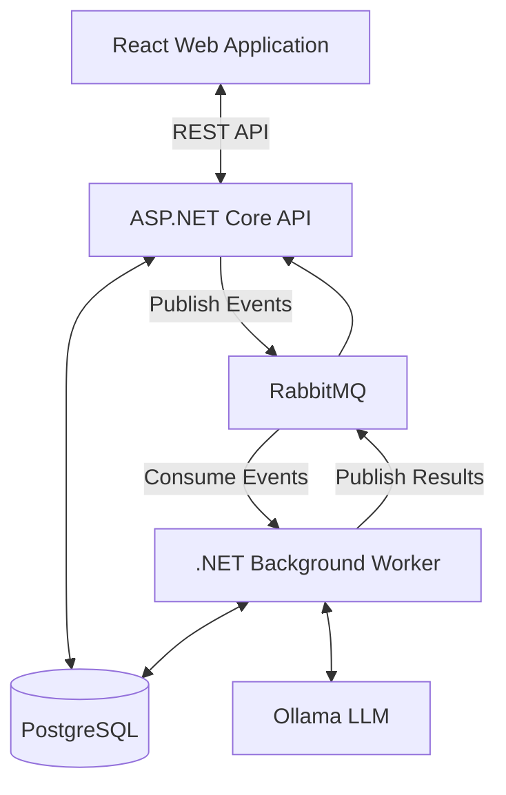

# FixFlow
### Intelligent Issue Reporting & Technician Matching Platform

FixFlow is an AI-powered maintenance and repair management platform that transforms natural-language problem reports into structured work orders and connects customers with qualified, reliable technicians through intelligent matching and performance-based recommendations.

**AI-Powered · Event-Driven · Modular Monolith · Production-Oriented**

---

## 1. Overview

Finding the right technician for a maintenance problem is often difficult. Customers may not know the technical cause of an issue, which trade is required, or whether a service provider is genuinely qualified.

FixFlow addresses these challenges through AI-assisted issue analysis, verified technician profiles, deterministic recommendation algorithms, and an authoritative work-order management system.

### Key Objectives

- Simplify maintenance issue reporting through natural language.
- Automatically identify issue categories, required skills, and potential risks.
- Recommend suitable technicians using transparent scoring algorithms.
- Establish trust through qualification verification and performance tracking.
- Manage repair workflows through controlled work-order lifecycles.
- Improve service quality through customer feedback and historical performance.

## 2. Core Capabilities

| Feature | Description |
|---|---|
| Intelligent Issue Reporting | Submit maintenance problems using natural-language descriptions and supporting images. |
| AI Issue Analysis | Automatically identify categories, required skills, risk levels, and issue summaries. |
| Priority Assessment | Calculate issue priority using deterministic business rules. |
| Technician Matching | Rank eligible technicians using skills, experience, performance, and availability. |
| Qualification Verification | Admin-reviewed certificates, licenses, portfolios, and alternative experience evidence. |
| Work Order Management | Govern assignments, acceptance, progress, completion, and reopening. |
| Resolution Verification | Allow customers to verify completed work and provide feedback. |
| Performance Analytics | Maintain technician scorecards using historical service outcomes. |
| Notifications | Deliver event-driven updates throughout the service lifecycle. |
| Administration | Manage users, technician verification, operational activities, and audit records. |

## 3. User Roles

**Customer / Reporter**
- Report maintenance issues.
- Review AI analysis and recommendations.
- Select technicians and track work orders.
- Verify resolutions and submit feedback.

**Technician**
- Create and manage professional profiles.
- Maintain trade skills and experience.
- Submit qualifications and work portfolios.
- Accept assignments and update job progress.
- Track personal performance metrics.

**Administrator**
- Review technician qualifications and verification requests.
- Manage user accounts and account suspensions.
- Monitor issues and work orders.
- Inspect administrative audit logs and system health.

## 4. Intelligent Matching Algorithm

FixFlow uses a weighted, deterministic scoring model to rank eligible technicians.

| Matching Factor | Weight |
|---|---:|
| Verified Skill Match | 40% |
| Experience & Verification | 25% |
| Historical Performance | 20% |
| Availability | 15% |
| **Total** | **100%** |

The final recommendation score is calculated as:

\[
S = 0.40M + 0.25E + 0.20P + 0.15A
\]

Where each component is normalized to a score between 0 and 100.

**Eligibility filtering is performed before ranking.** Technicians must satisfy applicable qualification, verification, service-area, and availability requirements. Mandatory legal qualifications cannot be bypassed through a high recommendation score.

## 5. AI-Powered Issue Analysis

FixFlow integrates locally hosted LLM inference using Ollama to understand unstructured maintenance descriptions.

The asynchronous analysis pipeline:

1. Receives a newly reported issue.
2. Publishes an analysis event through RabbitMQ.
3. Processes the event using a background worker.
4. Invokes the configured Ollama model.
5. Extracts structured issue information.
6. Validates the response against JSON schemas and business rules.
7. Persists the analysis and updates the issue processing status.

**AI capabilities**
- Issue category classification.
- Required skill extraction.
- Risk assessment.
- Natural-language issue summarization.
- Post-resolution insights and preventive recommendations.

AI-generated information is treated as untrusted input. Authoritative business decisions, including issue prioritization, technician eligibility, and work-order transitions, remain under backend control.

## 6. Work Order Lifecycle

FixFlow enforces an authoritative backend-managed state machine.

```text
PENDING_ACCEPTANCE
        |
        v
     ACCEPTED
        |
        v
    IN_PROGRESS
        |
        v
 AWAITING_REPORTER
        |
   +----+----+
   |         |
   v         v
VERIFIED  REOPENED
```

Additional transitions cover rejection, cancellation, and SLA expiration.

Every permitted transition is validated against the acting user's permissions and current business state. Work-order history provides an auditable record of operational changes.

## 7. Technical Architecture

FixFlow follows a **Modular Monolith architecture** with independently executing background workers for asynchronous processing.



**Architectural principles**
- Modular business domains with explicit boundaries.
- Separation of domain, application, and infrastructure concerns.
- Asynchronous event-driven background processing.
- Backend-enforced authorization and business invariants.
- Reliable message handling and idempotent event processing.
- Automated testing and architecture boundary validation.

### Backend Modules

| Module | Responsibility |
|---|---|
| Identity | Authentication, JWT and role management |
| Issues | Issue reporting and prioritization |
| Matching | Technician eligibility and ranking |
| Technicians | Profiles, skills and qualification verification |
| WorkOrders | Work-order lifecycle management |
| Resolutions | Customer verification, ratings and rework |
| Performance | Historical scorecards and calculations |
| Notifications | In-app and event-driven notifications |
| Administration | Verification governance and audit logs |

## 8. Technology Stack

| Layer | Technologies |
|---|---|
| Frontend | React 19, TypeScript, Vite |
| Styling | Tailwind CSS |
| State Management | TanStack Query |
| Forms & Validation | React Hook Form, Zod |
| Frontend Testing | Vitest, React Testing Library |
| Backend | .NET 10 LTS, C# 14, ASP.NET Core |
| ORM | Entity Framework Core |
| Authentication | ASP.NET Core Identity, JWT |
| Backend Validation | FluentValidation |
| Messaging | RabbitMQ, MassTransit |
| Database | PostgreSQL |
| AI Engine | Ollama, Llama 3.2 3B |
| Backend Testing | xUnit, integration testing |
| Architecture Testing | NetArchTest |
| Infrastructure | Docker, Docker Compose |
| CI/CD | GitHub Actions |

*The backend target is .NET 10 LTS. Existing .NET 9 project components must be aligned with the target framework and compatible package versions before feature implementation.*

## 9. Repository Structure

```text
FixFlow/
├── .github/
│   └── workflows/             # GitHub Actions pipelines
├── apps/
│   ├── web/                   # React + TypeScript frontend
│   ├── api/                   # ASP.NET Core modular monolith
│   └── worker/                # Background processing service
├── contracts/
│   ├── events/                # Integration event contracts
│   └── schemas/                # AI JSON schemas
├── docs/                       # Architecture and product documentation
├── infra/
│   ├── docker/                # Dockerfiles and Nginx configuration
│   └── scripts/               # Infrastructure helper scripts
├── tests/
│   ├── FixFlow.UnitTests/
│   ├── FixFlow.IntegrationTests/
│   └── FixFlow.ArchitectureTests/
├── .env.example
├── docker-compose.yml
├── Directory.Build.props
├── FixFlow.sln
├── AGENTS.md
├── CONTRIBUTING.md
└── README.md
```

## 10. Development Roadmap & Progress

FixFlow follows a milestone-driven development approach. Each phase is updated only after its implementation and verification criteria have been satisfied.

**Status Legend**

- ⬜ Planned
- 🟡 In Progress
- ✅ Completed & Verified

| Phase | Development Milestone | Status |
|---|---|---|
| 0 | Engineering Foundation, Architecture & Infrastructure | 🟡 In Progress |
| 1 | Identity, Authentication & Authorization | ⬜ Planned |
| 2 | Technician Profiles & Qualification Verification | ⬜ Planned |
| 3 | Issue Reporting & Management | ⬜ Planned |
| 4 | Asynchronous AI Issue Analysis | ⬜ Planned |
| 5 | Technician Eligibility & Matching Engine | ⬜ Planned |
| 6 | Work Order Lifecycle & SLA Management | ⬜ Planned |
| 7 | Resolution Verification & Customer Feedback | ⬜ Planned |
| 8 | Technician Performance & Scorecards | ⬜ Planned |
| 9 | Notifications & Administration | ⬜ Planned |
| 10 | Frontend Integration & User Experience Completion | ⬜ Planned |
| 11 | System Integration, Security & Testing | ⬜ Planned |
| 12 | CI/CD, Production Deployment & Observability | ⬜ Planned |

### Phase Deliverables

- **Phase 0:** Repository standards, modular architecture, Docker environment, database foundation and CI pipeline.
- **Phase 1:** Registration, authentication, JWT, role-based access and account security.
- **Phase 2:** Technician profiles, trade skills, qualification documents and administrative verification.
- **Phase 3:** Issue creation, attachments, persistence and deterministic priority calculation.
- **Phase 4:** RabbitMQ integration, Ollama inference, structured AI responses and failure recovery.
- **Phase 5:** Eligibility filtering, weighted scoring, technician ranking and recommendation explanations.
- **Phase 6:** Work-order creation, state transitions, SLA enforcement and status history.
- **Phase 7:** Resolution submission, customer verification, ratings and rework requests.
- **Phase 8:** Performance metrics, historical scorecards and ranking updates.
- **Phase 9:** Notifications, administrative workflows and audit management.
- **Phase 10:** Complete customer, technician and administrator interfaces.
- **Phase 11:** End-to-end testing, security hardening, reliability and performance optimization.
- **Phase 12:** Automated deployment, production configuration, monitoring, backups and release management.

See `docs/` for detailed specifications, implementation decisions and technical documentation.

## 11. Getting Started

### Prerequisites

- Git
- Docker Desktop / Docker Engine
- .NET 10 SDK
- Node.js LTS and npm
- PowerShell (for Windows helper scripts)

### Clone Repository

```bash
git clone https://github.com/HansiAshara/FixFlow.git
cd FixFlow
```

### Configure Environment

```powershell
Copy-Item .env.example .env
```

Configure the required database, RabbitMQ, JWT and Ollama settings in `.env`.

### Start Infrastructure

```bash
docker compose up -d
```

### Run Backend API

```bash
dotnet run --project apps/api/FixFlow.Api.csproj
```

### Run Background Worker

```bash
dotnet run --project apps/worker/FixFlow.Worker.csproj
```

### Run Frontend

```bash
cd apps/web
npm ci
npm run dev
```

Refer to `docs/` and `AGENTS.md` for detailed development instructions.

## 12. Database Migrations

FixFlow uses Entity Framework Core code-first migrations.

```bash
# Create a migration
dotnet ef migrations add <MigrationName> \
  --project apps/api/FixFlow.Api.csproj

# Apply migrations
dotnet ef database update \
  --project apps/api/FixFlow.Api.csproj
```

Production migrations must be reviewed and applied through a controlled deployment process.

## 13. Testing & Quality Assurance

### Backend

```bash
dotnet test FixFlow.sln
```

### Frontend

```bash
cd apps/web

npm run typecheck
npm run lint
npm run test
npm run build
```

Testing covers business rules, matching algorithms, authorization, work-order transitions, persistence, event processing, and frontend workflows.

## 14. Continuous Integration & Deployment

GitHub Actions is used to automate quality checks and application delivery.

**Continuous Integration**
- Backend restore and build.
- Unit, integration and architecture tests.
- Frontend type checking and linting.
- Frontend automated tests and production build.
- Docker configuration validation.
- Container image build.

**Continuous Deployment**
- Feature branches: automated validation.
- `develop`: staging deployment.
- `main`: production release workflow.
- Version tags: versioned application releases.

Production deployment includes protected environments, secure secrets, health verification and rollback procedures.

## 15. Security & Reliability

FixFlow follows security-first engineering practices:

- JWT authentication and backend-enforced authorization.
- Role-based access control and resource ownership validation.
- Secure password hashing and token lifecycle management.
- Server-side request validation.
- MIME-type restrictions and secure file storage.
- AI output validation and trust-boundary enforcement.
- Idempotent event processing and reliable message handling.
- Centralized error handling using RFC 7807 Problem Details.
- Audit trails for sensitive administrative operations.
- Secure configuration and secret management.
- Automated testing and dependency maintenance.

## 16. Future Enhancements

Potential improvements beyond the initial release:

- Real-time updates using SignalR.
- Advanced location-based technician discovery.
- More sophisticated recommendation models.
- Multi-provider AI support.
- Advanced operational analytics.
- Mobile application for customers and technicians.

---

**FixFlow — Turning maintenance problems into accountable, intelligent service solutions.**

