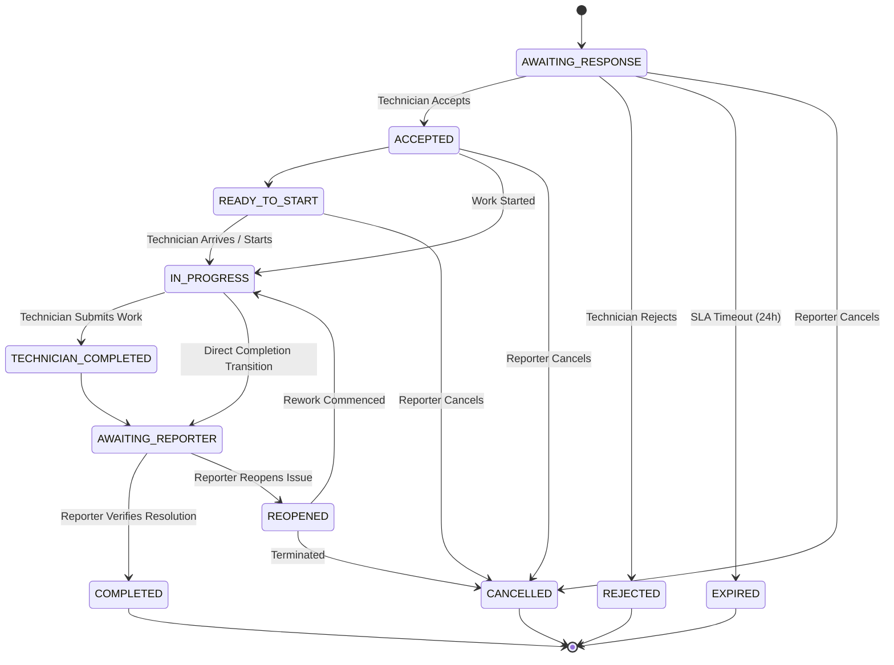

# FixFlow - Work Order State Machine Specification

## 1. Approved State Diagram

## 2. Transition Authority Matrix

| Current State | Target State | Authorized Actor | Pre-Conditions |
| :--- | :--- | :--- | :--- |
| `AWAITING_RESPONSE` | `ACCEPTED` | Assigned Technician | Before `AwaitingResponseUntilUtc` |
| `AWAITING_RESPONSE` | `REJECTED` | Assigned Technician | Valid rejection reason provided |
| `AWAITING_RESPONSE` | `EXPIRED` | System Worker | `UtcNow > AwaitingResponseUntilUtc` |
| `AWAITING_RESPONSE` | `CANCELLED` | Issue Reporter | Before acceptance |
| `ACCEPTED` | `IN_PROGRESS` | Assigned Technician | On-site arrival |
| `IN_PROGRESS` | `AWAITING_REPORTER`| Assigned Technician | Summary & completion notes provided |
| `AWAITING_REPORTER` | `COMPLETED` | Issue Reporter | Verification rating provided (1–5) |
| `AWAITING_REPORTER` | `REOPENED` | Issue Reporter | Specific rework reason provided |

All transitions are strictly validated in `WorkOrderStateMachine.cs`. Any attempt to trigger an invalid transition throws a `ConflictException` translated to an RFC 7807 HTTP 409 response.
